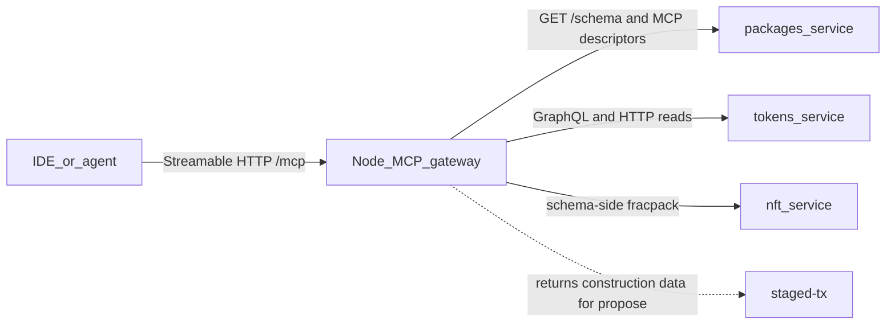
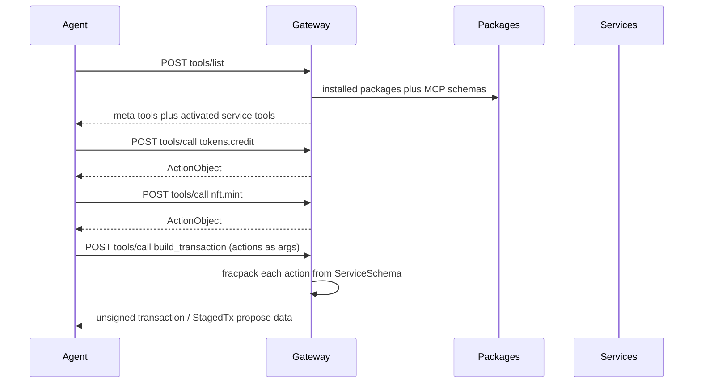

# On-chain service MCP schemas

A node-hosted Model Context Protocol (MCP) gateway that reads a per-service MCP schema from chain, exposes actions/queries/RPC/plugins as tools, and helps an agent construct one multi-service transaction.

**The gateway does not execute tools.** It gives agents schema and awareness of on-chain service actions, and it only constructs transactions or returns transaction-construction data. It is a developer-experience mechanism for agents building apps on existing on-chain services. Signing and pushing stay with the user's own client.

Yes: an MCP server can run on a node and be reached remotely by an IDE. We target MCP spec **2026-07-28** Streamable HTTP: a single POST endpoint, JSON responses only (no streaming), no protocol sessions. Cursor, Claude, and similar clients can add that URL as a remote MCP server.

Do **not** give each service its own MCP server. An agent cannot usefully knit a multi-service transaction if it must open a new connection per account. Each service **publishes a schema**; the **node runs one gateway** that reads those schemas and exposes tools.

## What already exists

The write path an agent needs is already on chain. A transaction is just an ordered list of actions; each action names `sender`, `service`, `method`, and packed `rawData`. The JS client already packs many actions then pushes one transaction ([`rpc.ts`](packages/user/CommonApi/common/packages/common-lib/src/rpc.ts)).

Per-service **action** schemas are already stored and served:

- Install writes [`InstalledSchema`](packages/user/Packages/include/services/user/Packages.hpp) (`account` + [`ServiceSchema`](libraries/psibase/common/include/psibase/schema.hpp): types, actions, events, tables).
- [`GET /schema?service=tokens`](packages/user/Packages/src/RPackages.cpp) on the `packages` subdomain returns that JSON.
- `POST {service}/pack_action/{method}` packs one action **when the service wired** [`servePackAction`](libraries/psibase/common/include/psibase/servePackAction.hpp) — this is opt-in, not universal.
- The reliable pack path is **schema-side**: fetch `ServiceSchema`, pack JSON with fracpack (Rust `PrettyAction` and the Python test client already do this). The gateway should pack from schema and treat `/pack_action` as a convenience, not a dependency.
- `GET {service}/action_templates` returns placeholder JSON, not a real schema.

Reads are also already HTTP:

- `GET {service}/graphql` returns GraphQL SDL; `POST {service}/graphql` runs a query ([`serveGraphQL.hpp`](libraries/psibase/common/include/psibase/serveGraphQL.hpp)).
- GraphQL often lives on a **separate query-service account** (`profiles+1`, `registry+1`), not on the action service. Descriptors must link the pair.
- Other RPC lives in each service's `serveSys` (not catalogued today).
- Plugin WebAssembly Interface Type (WIT) worlds can be extracted by [`component-parser`](packages/user/CommonApi/common/packages/component-parser/src/lib.rs).

Discovery today is N+1: paginate `packages` GraphQL `installed { services }`, then `GET /schema?service=` per account. There is no bulk catalog. The gateway caches this; a later `GET /mcp-schema?all=1` (or include MCP descriptors in `installed()`) avoids repeating that from every client.

What is **missing** for an AI: human descriptions, a unified tool catalog, a stateless transaction-construction path, and a declared HTTP/plugin surface. `ServiceSchema` has types only — no prose, examples, or side-effect labels. It also lists `serveSys` as an action; generated tools must drop HTTP handlers and keep only transaction methods.

The existing Cursor MCP server lives in the sibling `psibase-dev-tools` repo (`psibase-mcp`, 19 static build/test/chain tools over stdio). It has no chain introspection, no signing, and no per-service tools. Keep it as the **dev-host** server; do not grow it into the on-chain gateway.

## Layer 1 — per-service MCP schema (the on-chain artifact)

Each service account gets an **MCP Service Descriptor** stored beside `InstalledSchema`. This is what “each service comes with its own MCP protocol schema” means.

**Hybrid authorship:**

1. **Generate** a baseline at package build/install from `ServiceSchema`, `GET /graphql` SDL, and plugin WIT.
2. **Override** with an optional authored file in the package (e.g. `mcp.json` / `mcp.yaml`) for descriptions, examples, hidden/dangerous tools, GraphQL operation templates, and HTTP routes that cannot be inferred.

Suggested shape (logical, not final JSON):

- `service`, `title`, `description`, `version`
- `queryService` — optional sibling account that hosts GraphQL (`tokens+1`)
- `exports` — package export names that resolve to this account (agents search by logical name, not only `AccountNumber`)
- `tools[]`, each with:
  - `name` — short, unique within the service (`credit`, not `tokens_credit`)
  - `kind` — `action` | `graphql` | `http` | `plugin`
  - `description` + `examples` (this is what makes tools usable by a model)
  - `inputSchema` — JSON Schema derived from fracpack / GraphQL / WIT types
  - `sideEffect` — `read` | `write` | `mixed`
  - `auth` — who must sign / which sender is implied
  - kind-specific payload: action method, GraphQL document, HTTP path+method, or WIT `interface.func`

Store it like schemas today: an `InstalledMcpSchema` row (or a well-known Sites file such as `/mcp/schema.json`) plus `GET /mcp-schema?service=…` on `packages` (or on the service itself).

Generation should be automatic for every installed service so first-party and third-party packages work without a hand-written file. Authored files are quality, not a gate.

## Layer 2 — one gateway on the node

Add a node-reachable MCP endpoint, e.g. `https://<host>/mcp` or the `mcp` subdomain.

The gateway is a protocol translator; all truth still comes from chain HTTP/tables. **Descriptors live on chain; subjective state is node-local.**

### Transport: MCP 2026-07-28 Streamable HTTP

The 2026-07-28 revision replaces the 2025 session model. There is no `initialize` handshake, no `Mcp-Session-Id`, no GET stream, and no `Last-Event-ID` resume.

**Both revisions on one endpoint (decided).** The gateway serves 2025-era clients (2025-03-26 through 2025-11-25) and 2026-07-28 clients on the same `/mcp` endpoint, as the Python and TypeScript SDKs do. It implements `server/discover` (required by 2026-07-28, and the probe new clients use to pick a version) and still answers the 2025 `initialize` handshake and `Mcp-Session-Id`; a 2025 GET for a stream gets `405 Method Not Allowed`, which the 2025 spec permits. The revision is chosen per request from `MCP-Protocol-Version` / `_meta`, or by an `initialize` call. Reason: Cursor and most other clients still speak 2025; as of Oct 2026 only Claude Code and GitHub Copilot CLI use 2026-07-28 by default. Cursor staff have said its fallback misreads the 400 from servers that only speak the new revision, with no client-side workaround, so dropping the 2025 path would lock Cursor out. A 2025 session is a thin compatibility shim: its id maps to the same per-user state as the stateless path, and nothing new depends on it.

- **One POST endpoint.** Every client message is its own POST. `Accept` lists both `application/json` and `text/event-stream`.
- **Required headers:** `MCP-Protocol-Version` (must match the body), `Mcp-Method`, and `Mcp-Name` for `tools/call`, `resources/read`, `prompts/get`. Mismatch with the body is rejected.
- **Metadata in `params._meta`:** `protocolVersion`, `clientInfo`, `clientCapabilities`.
- **Response:** always a single JSON response. Notifications get `202 Accepted`.
- **No server-initiated requests.** When the server needs input it returns `InputRequiredResult`; the client retries with `inputResponses`.
- **No streaming (decided).** The MCP spec requires Server-Sent Events (SSE) support, but the gateway has no need to stream right now, so streaming will not be supported: no request-scoped SSE responses, no `subscriptions/listen` stream, no progress updates, and no `notifications/tools/list_changed`. Clients see the current tool list on their next `tools/list`.
- **Must** validate `Origin` (403 on mismatch), require auth, and bind to localhost when running locally.

**WebSocket** is an optional custom transport for our own clients; Streamable HTTP is required for interop.

**Host choice:** with no streaming, every response fits psibase's single-buffer `HttpReply`, so a local-service (WASM) gateway is viable; a native psinode (or thin sidecar) adapter remains an option.

### Stateless

Any node answers any request. Activated services and drafts are keyed by the logged-in user or passed as tool arguments — never by an MCP session.

### State storage

- **Subjective DB:** tokens, rate counters, preferences, activated state, keyed by user.
- **Session DB:** sockets (cleared on node restart).
- Per-node and not replicated. Writes must be safe under subjective-transaction auto-retry. Verify the caller on every access.
- **Budget ~4–64 KB per user.** References: ToolHive reports 10–50 KB per session; OAuth tokens are ~1–2 KB.
- Hard caps and expiry on any buffers; XTimer cleanup of expired rows.
- Store auth references only, never keys. WsAuth for sockets.

Remote access is just HTTPS to that endpoint. Bind/auth policy is separate from schema (see Security).

## Layer 3 — tools the agent actually sees

Dumping every action + GraphQL field + WIT func on a live chain will blow past client tool-list limits. Use **activation**, not a 500-tool dump.

**Always-on meta tools**

- `list_services` — installed packages/accounts, short blurb
- `use_services` — activate `["tokens","nft",…]` for the logged-in user; those tools appear (picked up on the client's next `tools/list`; no change notification)
- `describe_service` — full descriptor for one account
- `graphql` / `http_call` — escape hatches for reads not promoted to named tools
- `draft_status` / `clear_draft` — optional user-keyed draft
- `build_transaction` — fracpack + TAPOS (transaction as proof of stake / last-irreversible ref); returns the unsigned transaction or StagedTx `propose` data. It does not sign or push.

**Activated service tools** (the “simple tool calls”)

- `tokens.credit`, `tokens.uncredit`, …
- Named GraphQL ops from the descriptor (`tokens.getBalance`)
- Declared HTTP routes
- Plugin funcs **only on a host that can run plugins** (below)

**Write tools never push.** They validate args against the descriptor and return a typed `ActionObject` `{sender, service, method, data}`. `build_transaction` turns a list of them into construction data. That is how the agent knits Tokens + Nft + Invite into one atomic transaction.

Draft state: default **stateless** (client passes the action list into `build_transaction`), with an **optional draft keyed by the logged-in user** in the subjective DB.

Reads (GraphQL/HTTP) return immediately and never enter the draft.

## Mapping the four surfaces

| Surface | Discover | Gateway output |
|---|---|---|
| Actions | `ServiceSchema` minus `serveSys` / other HTTP handlers + MCP overrides. Skip hashed `#…` method names unless the descriptor gives a human alias. | Packed action / construction data from schema (fracpack); `/pack_action` only if present |
| GraphQL | `GET {queryService}/graphql` SDL + named ops in MCP file | Read via `POST {queryService}/graphql` |
| HTTP/RPC | **Authored** in MCP file (`pack_action` / `graphql` / `action_templates` are known builtins) | Sibling-subdomain HTTP |
| Plugin WIT | WIT via component-parser + MCP overrides | **Not on the node** |

Plugins run in the browser Supervisor ([`plugin-host.ts`](packages/user/Supervisor/ui/src/plugin/plugin-host.ts)): prompts, keys, IndexedDB. A node MCP cannot honestly implement `kind: plugin`. Same descriptor, two hosts:

- **Node gateway** — actions, GraphQL, HTTP, transaction construction
- **Browser / Supervisor MCP** (later) — WIT tools, using the same schema

Until the browser host exists, plugin tools are listed as `unsupported` on the node gateway (description only) so the agent knows they exist but does not fake a call.

## Signing and auth

The gateway never signs or pushes, and a remotely reachable node must not hold user keys.

1. **Default:** `build_transaction` returns the unsigned transaction, or the data for a [StagedTx](packages/system/StagedTx) `propose`. The user's client (wallet, Supervisor, `psibase` CLI) signs and submits.
2. **Later:** `InputRequiredResult` can prompt the client for missing data (e.g. sender, confirmation); still no server-side signing.

`sender` is an explicit argument on write tools (or a per-user default in subjective state). The gateway does not invent the acting account.

## Security (non-optional if the endpoint is remote)

- Classify every tool `read` vs `write`. Writes only return construction data.
- Hide or extra-confirm system-dangerous actions (`setCode`, auth changes, package install) unless the caller is privileged.
- Authenticate the `/mcp` endpoint (bearer token, mTLS, or localhost bind) and validate `Origin` (403). Open CORS + no auth on a public producer is a write oracle.
- Rate-limit `build_transaction` / GraphQL (counters in subjective DB, keyed by user).
- Schema allowlists: authors can `exclude` tools; the gateway can have a node-level deny list.

## What we would build (when you want implementation)

This is design-only until you ask to implement.

1. **Descriptor spec** — JSON Schema for the MCP Service Descriptor; fracpack/`ServiceSchema` → JSON Schema mapping; GraphQL SDL / WIT import rules.
2. **Install path** — generate baseline at `setSchema` / postinstall; accept optional `mcp.json` from the package; serve `GET /mcp-schema?service=`.
3. **Gateway** — psinode (or sidecar) Streamable HTTP `/mcp` per 2026-07-28; meta tools + activation; transaction construction; GraphQL/HTTP reads; subjective state.
4. **Seed descriptors** — hand-enrich a few high-value services (Tokens, Accounts, Packages, StagedTx) so the first agent loop is actually good.
5. **Browser host (follow-up)** — Supervisor MCP implementing `kind: plugin` against the same descriptors.

## Open decisions (defaults above unless overridden)

- Construction output format: unsigned transaction vs StagedTx `propose` data (or both).
- WebSocket custom transport: build now for our clients, or later.
- Per-user state caps and expiry values within the 4–64 KB budget.
- How aggressively to hide system actions on a public node.

The existing `psibase-mcp` dev tool stays separate from this gateway.
