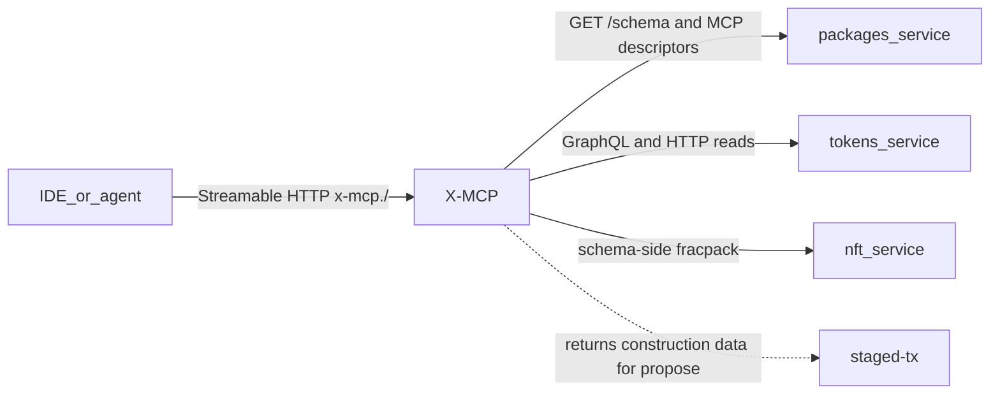
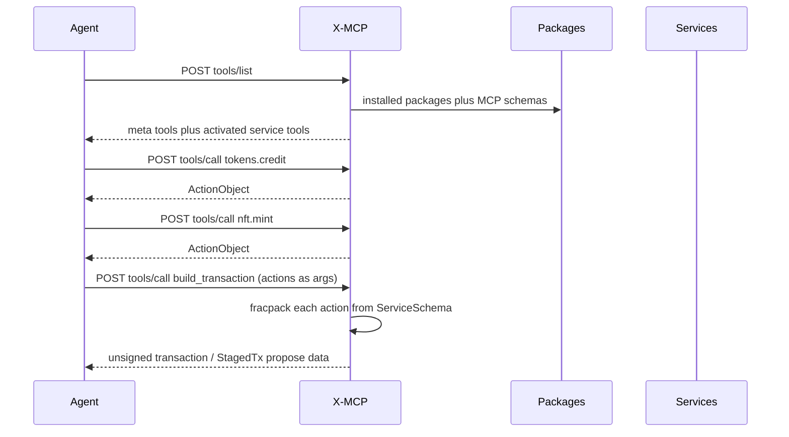

# On-chain service MCP schemas — V2

V2 reframes V1 (`mcp-server-on-chain-v1.md`). The technical design carries over; the value proposition changes.

**X-MCP is a schema-and-builder tool.** It gives an agent awareness of on-chain service tools (what is deployed, what each action takes) and constructs transactions or returns construction data. **It never runs tools, signs, or pushes.**

**Primary use: an agent operating a live chain.** At runtime the agent asks X-MCP what is deployed, turns a user prompt ("send 10 tokens to alice and mint her an NFT") into typed actions, and gets back one transaction to sign. Building apps on existing services (V1's developer-experience framing) is still supported, but is a secondary use.

**Signing is the handoff.** X-MCP's output ends at an unsigned transaction (or StagedTx `propose` data). Whatever holds a key, whether the user's client or the agent's own delegated key, signs and submits. How the agent gets signing authority safely is the main open problem (see Signing and delegation).

Transport: MCP spec **2026-07-28** Streamable HTTP: a single POST endpoint, JSON responses only (no streaming), no protocol sessions, with 2025 clients still served on the same endpoint. Cursor, Claude, and similar clients add the URL as a remote MCP server.

Do **not** give each service its own MCP server. An agent cannot usefully knit a multi-service transaction if it must open a new connection per account. Each service **publishes a schema**; the **node runs one X-MCP** that reads those schemas and exposes tools.

## What already exists

The write path an agent needs is already on chain. A transaction is just an ordered list of actions; each action names `sender`, `service`, `method`, and packed `rawData`. The JS client already packs many actions then pushes one transaction ([`rpc.ts`](packages/user/CommonApi/common/packages/common-lib/src/rpc.ts)).

Per-service **action** schemas are already stored and served:

- Install writes [`InstalledSchema`](packages/user/Packages/include/services/user/Packages.hpp) (`account` + [`ServiceSchema`](libraries/psibase/common/include/psibase/schema.hpp): types, actions, events, tables).
- [`GET /schema?service=tokens`](packages/user/Packages/src/RPackages.cpp) on the `packages` subdomain returns that JSON.
- `POST {service}/pack_action/{method}` packs one action **when the service wired** [`servePackAction`](libraries/psibase/common/include/psibase/servePackAction.hpp) — this is opt-in, not universal.
- The reliable pack path is **schema-side**: fetch `ServiceSchema`, pack JSON with fracpack (Rust `PrettyAction` and the Python test client already do this). X-MCP should pack from schema and treat `/pack_action` as a convenience, not a dependency.
- `GET {service}/action_templates` returns placeholder JSON, not a real schema.

Reads are also already HTTP:

- `GET {service}/graphql` returns GraphQL SDL; `POST {service}/graphql` runs a query ([`serveGraphQL.hpp`](libraries/psibase/common/include/psibase/serveGraphQL.hpp)).
- GraphQL often lives on a **separate query-service account** (`profiles+1`, `registry+1`), not on the action service. Descriptors must link the pair.
- Other RPC lives in each service's `serveSys` (not catalogued today).
- Plugin WebAssembly Interface Type (WIT) worlds can be extracted by [`component-parser`](packages/user/CommonApi/common/packages/component-parser/src/lib.rs).

Discovery today is N+1: paginate `packages` GraphQL `installed { services }`, then `GET /schema?service=` per account. There is no bulk catalog. X-MCP caches this; a later `GET /mcp-schema?all=1` (or include MCP descriptors in `installed()`) avoids repeating that from every client.

What is **missing** for an agent: human descriptions, a unified tool catalog, a stateless transaction-construction path, and a declared HTTP/plugin surface. `ServiceSchema` has types only — no prose, examples, or side-effect labels. It also lists `serveSys` as an action; generated tools must drop HTTP handlers and keep only transaction methods.

The existing Cursor MCP server lives in the sibling `psibase-dev-tools` repo (`psibase-mcp`, 19 static build/test/chain tools over stdio). It has no chain introspection, no signing, and no per-service tools. Keep it as the **dev-host** server; do not grow it into the on-chain X-MCP.

## Layer 1 — per-service MCP schema (the on-chain artifact)

Each service account gets an **MCP Service Descriptor** stored beside `InstalledSchema`. This is what “each service comes with its own MCP protocol schema” means.

**Hybrid authorship:**

1. **Generate** a baseline at package build/install from `ServiceSchema`, `GET /graphql` SDL, and plugin WIT.
2. **Override** with an optional authored file in the package (e.g. `mcp.json` / `mcp.yaml`) for descriptions, examples, hidden/dangerous tools, GraphQL operation templates, and HTTP routes that cannot be inferred.

Suggested shape (logical, not final JSON):

- `service`, `title`, `description`, `version`
- `queryService` — optional sibling account that hosts GraphQL (`tokens+1`)
- `exports` — package export names that resolve to this account (agents search by logical name, not only `AccountNumber`)
- `tools[]`, each with:
  - `name` — short, unique within the service (`credit`, not `tokens_credit`)
  - `kind` — `action` | `graphql` | `http` | `plugin`
  - `description` + `examples` (this is what makes tools usable by a model)
  - `inputSchema` — JSON Schema derived from fracpack / GraphQL / WIT types
  - `sideEffect` — `read` | `write` | `mixed`
  - `auth` — who must sign / which sender is implied
  - kind-specific payload: action method, GraphQL document, HTTP path+method, or WIT `interface.func`

Store it like schemas today: an `InstalledMcpSchema` row (or a well-known Sites file such as `/mcp/schema.json`) plus `GET /mcp-schema?service=…` on `packages` (or on the service itself).

Generation should be automatic for every installed service so first-party and third-party packages work without a hand-written file. Authored files are quality, not a gate.

## Layer 2 — one X-MCP on the node

Add a node-reachable MCP endpoint at the root of the `x-mcp` subdomain: `x-mcp.<root-name>/`, with no path segment. MCP lets a server publish any URL as its Streamable HTTP endpoint, so serving at root is valid.

X-MCP is a protocol translator; all truth still comes from chain HTTP/tables. **Descriptors live on chain; subjective state is node-local.**

### Transport: MCP 2026-07-28 Streamable HTTP

The 2026-07-28 revision replaces the 2025 session model. There is no `initialize` handshake, no `Mcp-Session-Id`, no GET stream, and no `Last-Event-ID` resume.

**Both revisions on one endpoint (decided).** X-MCP serves 2025-era clients (2025-03-26 through 2025-11-25) and 2026-07-28 clients on the same `x-mcp.<root-name>/` endpoint, as the Python and TypeScript SDKs do. It implements `server/discover` (required by 2026-07-28, and the probe new clients use to pick a version) and still answers the 2025 `initialize` handshake and `Mcp-Session-Id`; a 2025 GET for a stream gets `405 Method Not Allowed`, which the 2025 spec permits. The revision is chosen per request from `MCP-Protocol-Version` / `_meta`, or by an `initialize` call. Reason: Cursor and most other clients still speak 2025; as of Oct 2026 only Claude Code and GitHub Copilot CLI use 2026-07-28 by default. Cursor staff have said its fallback misreads the 400 from servers that only speak the new revision, with no client-side workaround, so dropping the 2025 path would lock Cursor out. A 2025 session is a thin compatibility shim: its id maps to the same per-user state as the stateless path, and nothing new depends on it.

- **One POST endpoint.** Every client message is its own POST. `Accept` lists both `application/json` and `text/event-stream`.
- **Required headers:** `MCP-Protocol-Version` (must match the body), `Mcp-Method`, and `Mcp-Name` for `tools/call`, `resources/read`, `prompts/get`. Mismatch with the body is rejected.
- **Metadata in `params._meta`:** `protocolVersion`, `clientInfo`, `clientCapabilities`.
- **Response:** always a single JSON response. Notifications get `202 Accepted`.
- **No server-initiated requests.** When the server needs input it returns `InputRequiredResult`; the client retries with `inputResponses`.
- **No streaming (decided).** The MCP spec requires Server-Sent Events (SSE) support, but X-MCP has no need to stream right now, so streaming will not be supported: no request-scoped SSE responses, no `subscriptions/listen` stream, no progress updates, and no `notifications/tools/list_changed`. Clients see the current tool list on their next `tools/list`.
- **Must** validate `Origin` (403 on mismatch), require auth, and bind to localhost when running locally.

**WebSocket** is an optional custom transport for our own clients; Streamable HTTP is required for interop.

**Host choice:** with no streaming, every response fits psibase's single-buffer `HttpReply`, so a local-service (WASM) X-MCP is viable; a native psinode (or thin sidecar) adapter remains an option.

### Stateless

Any node answers any request. Activated services and drafts are keyed by the logged-in user or passed as tool arguments — never by an MCP session.

### State storage

- **Subjective DB:** tokens, rate counters, preferences, activated state, keyed by user.
- **Session DB:** sockets (cleared on node restart).
- Per-node and not replicated. Writes must be safe under subjective-transaction auto-retry. Verify the caller on every access.
- **Budget ~4–64 KB per user.** References: ToolHive reports 10–50 KB per session; OAuth tokens are ~1–2 KB.
- Hard caps and expiry on any buffers; XTimer cleanup of expired rows.
- Store auth references only, never keys. WsAuth for sockets.

Remote access is just HTTPS to that endpoint. Bind/auth policy is separate from schema (see Security).

## Layer 3 — tools the agent actually sees

Dumping every action + GraphQL field + WIT func on a live chain will blow past client tool-list limits. Use **activation**, not a 500-tool dump.

**Always-on meta tools**

- `list_services` — installed packages/accounts, short blurb
- `use_services` — activate `["tokens","nft",…]` for the logged-in user; those tools appear (picked up on the client's next `tools/list`; no change notification)
- `describe_service` — full descriptor for one account
- `graphql` / `http_call` — escape hatches for reads not promoted to named tools
- `draft_status` / `clear_draft` — optional user-keyed draft
- `build_transaction` — fracpack + TAPOS (transaction as proof of stake / last-irreversible ref); returns the unsigned transaction (or StagedTx `propose` data) in both forms: (1) agent-readable structured JSON (TAPOS fields, then each action's sender, service, method, and decoded arguments) that the agent inspects directly, so it never needs its own unpacking tool; and (2) the packed bytes of the same unsigned transaction for the signing step. The client packs and signs from the JSON; the packed bytes are X-MCP's packing of that same JSON, so the client can verify they match (repack the JSON and compare) before signing. **(Decided.)** It does not sign or push.

**Activated service tools** (the “simple tool calls”)

- `tokens.credit`, `tokens.uncredit`, …
- Named GraphQL ops from the descriptor (`tokens.getBalance`)
- Declared HTTP routes
- Plugin funcs **only on a host that can run plugins** (below)

**Write tools never push.** They validate args against the descriptor and return a typed `ActionObject` `{sender, service, method, data}`. `build_transaction` turns a list of them into construction data. That is how the agent knits Tokens + Nft + Invite into one atomic transaction.

Draft state: default **stateless** (client passes the action list into `build_transaction`), with an **optional draft keyed by the logged-in user** in the subjective DB.

Reads (GraphQL/HTTP) return immediately and never enter the draft.

## Mapping the four surfaces

| Surface | Discover | X-MCP output |
|---|---|---|
| Actions | `ServiceSchema` minus `serveSys` / other HTTP handlers + MCP overrides. Skip hashed `#…` method names unless the descriptor gives a human alias. | Packed action / construction data from schema (fracpack); `/pack_action` only if present |
| GraphQL | `GET {queryService}/graphql` SDL + named ops in MCP file | Read via `POST {queryService}/graphql` |
| HTTP/RPC | **Authored** in MCP file (`pack_action` / `graphql` / `action_templates` are known builtins) | Sibling-subdomain HTTP |
| Plugin WIT | WIT via component-parser + MCP overrides | **Not on the node** |

Plugins run in the browser Supervisor ([`plugin-host.ts`](packages/user/Supervisor/ui/src/plugin/plugin-host.ts)): prompts, keys, IndexedDB. A node MCP cannot honestly implement `kind: plugin`. Same descriptor, two hosts:

- **Node X-MCP** — actions, GraphQL, HTTP, transaction construction
- **Browser / Supervisor MCP** (later) — WIT tools, using the same schema

Until the browser host exists, plugin tools are listed as `unsupported` on the node X-MCP (description only) so the agent knows they exist but does not fake a call.

## Signing and delegation

X-MCP never signs or pushes, and a remotely reachable node must not hold user keys. `build_transaction` returns the unsigned transaction (or [StagedTx](packages/system/StagedTx) `propose` data) as structured JSON plus packed bytes; the signer is outside X-MCP. `sender` is an explicit argument on write tools (or a per-user default in subjective state); X-MCP does not invent the acting account. `InputRequiredResult` can ask the client for a missing sender or confirmation.

Three ways an agent gets a signature, from least to most autonomous:

1. **Human in the loop.** The agent hands the transaction to the user's client (wallet, Supervisor, `psibase` CLI), which signs and submits. Safe; not autonomous.
2. **Base case: the user gives the agent their private key. Risky.** The agent signs as the user with full authority over the account: any service, any action, including auth changes. A prompt injection, a bad tool description, or a leaked agent log can drain or take over the account. Acceptable only for throwaway dev/test accounts.
3. **Next step: the agent gets its own key with limited access.** The agent has its own account and key; the user's account delegates to it, scoped per service:
   - [AuthDelegate](packages/system/AuthDelegate) — an account is authorized by a single `owner` account (`setOwner`). All or nothing: the owner can do anything the account can. Useful for "the agent owns a sub-account it operates", not for scoping.
   - [AuthDyn](packages/system/AuthDyn) — the account calls `set_mgmt(account, manager)` to hand its auth to a policy-manager service; after that only the manager can change management, so the manager is security-critical. Details below.

### POC signing path: headless UI (decided Oct 30, 2026)

For the POC, signing is done through a headless UI that the agent drives in a headless browser, using the existing Supervisor and auth-sig plugin key vault. Why:

1. No remote signing endpoint exists on psibase today.
2. x-keys can sign, but only for local node services; using it would mean the node holds user keys, breaking the rule that X-MCP never signs.
3. A local signing binary/CLI is the technically clean option, but it assumes the agent can run shell commands or write code. Not every agent can; some are text-in, text-out only.
4. The browser's Supervisor and auth-sig plugin already sign via the key vault, so driving them through a headless UI reuses existing auth machinery.
5. **Tradeoff:** a browser runtime must be maintained for one step, but it is the only path that works for every agent.

### Session-token style agent keys

Agent keys behave like session tokens rather than standing credentials: minted when the user approves a task, scoped to one service or action, destroyed/nulled after use, and expired by the chain-side auth infrastructure (the AuthDyn manager's policy), not by trusting the agent to discard them. Frequent rotation shrinks the blast radius of a leaked or injected agent.

### AuthDyn control surface

Sources: `packages/system/AuthDyn/service/src/lib.rs`, `rust/psibase/src/services/auth_dyn.rs`, `packages/system/StagedTx/service/src/policy.rs`.

- A policy is per account, optionally per service and per method: `get_policy(account, service_method)` returns weighted authorizer **accounts** plus a `threshold`; approval succeeds when approver weights reach it.
- The manager is blind to action arguments, transaction size, and signatures.
- AuthDyn accounts act only through StagedTx; direct signing is rejected (`checkAuthSys` aborts).

The manager **can**: allowlist or deny by service+method (`impossible()` denies); give each method its own signers and threshold; enforce time windows/expiry from the block clock and its own tables; do loose rate limits only via separate counter actions (`get_policy` is a read-only query).

The manager **cannot**: limit amounts or arguments (method is the finest grain); limit transaction size or fees; put raw keys in a policy; scope below first-level methods (nested authorizers are checked with method `None`); let the account act without StagedTx.

Examples: Guilds (`packages/user/Guilds/service/src/lib.rs`) blocks `setAuthServ`, `setCode`, and StagedTx `propose`/`accept`, falling back to the account's normal policy otherwise. Fractals uses a banned list plus per-method `ROLE_METHODS` policies.

### Delegated agent setup

1. Create an agent account with its own key (AuthSig).
2. Put the user account (or a sub-account) under a custom AuthDyn manager.
3. The manager returns `{agent: 1, threshold: 1}` for allowlisted methods, the owner for sensitive ones, and `impossible()` for `setCode` and auth changes.
4. The agent proposes a staged transaction and accepts it; it executes once the threshold is met.

Out-of-scope actions fail on chain rather than relying on the agent to behave.

### Proposer-checker pattern

Two agents: one proposes the staged transaction; the other checks limits AuthDyn can't see (amounts, arguments) and approves. When the parent (user) is part of approval, they see the full transaction contents before accepting.

X-MCP's role here is informational: descriptors carry `auth` per tool, and `build_transaction` can return StagedTx `propose` data for this flow. It does not enforce policy.

## Security (non-optional if the endpoint is remote)

- Classify every tool `read` vs `write`. Writes only return construction data.
- Treat tool descriptors as untrusted input to the agent: a malicious descriptor is a prompt-injection path toward whatever key the agent holds. Scoped delegation limits the blast radius.
- Hide or extra-confirm system-dangerous actions (`setCode`, auth changes, package install) unless the caller is privileged.
- Authenticate the `x-mcp.<root-name>/` endpoint (bearer token, mTLS, or localhost bind) and validate `Origin` (403). Open CORS + no auth on a public producer is a write oracle.
- Rate-limit `build_transaction` / GraphQL (counters in subjective DB, keyed by user).
- Schema allowlists: authors can `exclude` tools; X-MCP can have a node-level deny list.

## What we would build (when you want implementation)

This is design-only until you ask to implement.

1. **Descriptor spec** — JSON Schema for the MCP Service Descriptor; fracpack/`ServiceSchema` → JSON Schema mapping; GraphQL SDL / WIT import rules.
2. **Install path** — generate baseline at `setSchema` / postinstall; accept optional `mcp.json` from the package; serve `GET /mcp-schema?service=`.
3. **X-MCP** — psinode (or sidecar) Streamable HTTP at `x-mcp.<root-name>/` per 2026-07-28; meta tools + activation; transaction construction; GraphQL/HTTP reads; subjective state.
4. **Delegation policy manager** — a reference AuthDyn manager service that grants an agent key per-service/method scope.
5. **Seed descriptors** — hand-enrich a few high-value services (Tokens, Accounts, Packages, StagedTx) so the first agent loop is actually good.
6. **Browser host (follow-up)** — Supervisor MCP implementing `kind: plugin` against the same descriptors.

## Open decisions (defaults above unless overridden)

**Delegation model**
- Build a reference AuthDyn policy manager, or rely on existing ones (Guilds/Fractals style)? Who deploys it, and per user or shared?
- Manager admin actions for scope and expiry: how the user grants, narrows, expires, and revokes agent scope (only the manager can change AuthDyn management, so revocation must be a manager action).
- Is propose-then-accept smooth enough for agents, given AuthDyn accounts can only act through StagedTx?
- Amount/argument limits live in the target services (or a checker agent), since `get_policy` sees only service/method.
- Where AuthDelegate fits: agent-owned sub-accounts only?

**Autonomous signing without master keys**
- ~~What the agent-side signer looks like.~~ **Resolved for the POC:** a headless UI the agent drives in a headless browser, using the existing Supervisor and auth-sig key vault (see POC signing path under Signing and delegation).
- Whether out-of-scope actions automatically become StagedTx proposals for the user.
- How to make the risky base case (raw user key) visibly discouraged in docs and tooling.

**Installation, connection, and discovery** (decided Oct 30, 2026)
- **Endpoint URL (decided):** the endpoint is a local node: the user provides that node's URL, and that's the X-MCP endpoint.
- **Discovery mechanism (decided):** the MCP URL returns a list of tools with schemas (`tools/list` style), or a list of tools that allow further lookup of tool schemas. The agent uses it to learn what's callable on chain.
- **Addressing (decided):** addressed locally by node URL. The earlier chain-level service name routing idea is dropped. Nothing in X-MCP needs to be an objective (on-chain) service: everything either reads live chain state or shapes a transaction, and both are subjective, so schema/discovery serving is not an on-chain objective service either. An on-chain request-to-build pattern (the user signs a public request transaction before the real one is built) was considered and rejected.
- **Connection (decided for the POC):** no developer in the loop; this is a non-dev user feature. Bootstrap is three things given to the agent: a node URL, an account address, and a key for signing. Nothing else.
- **Name and packaging (decided):** the component is called **X-MCP**. It is a node-local package included in the default local package set, so it ships with the standard local installation instead of being something a user adds separately.

**Carried from V1**
- WebSocket custom transport: build now for our clients, or later.
- Per-user state caps and expiry values within the 4–64 KB budget.
- How aggressively to hide system actions on a public node.

The existing `psibase-mcp` dev tool stays separate from X-MCP.
