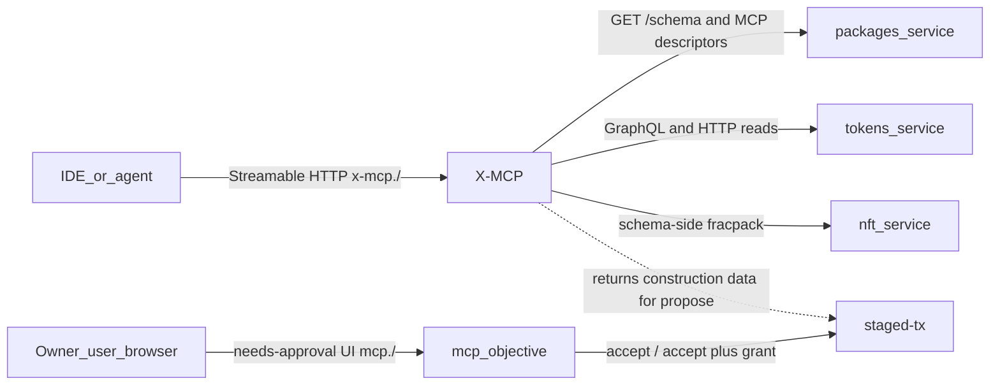
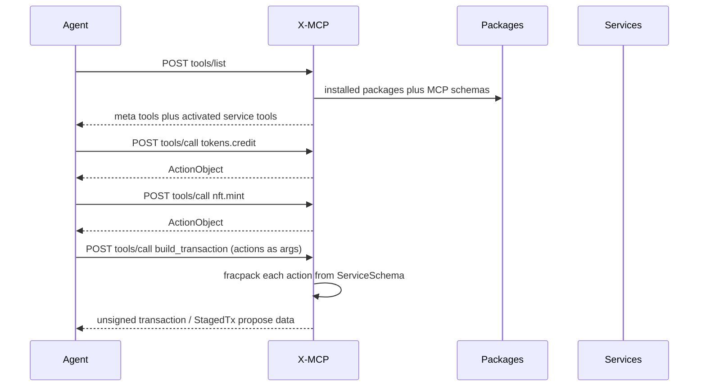

# On-chain service MCP schemas — V2

V2 reframes V1 (`mcp-server-on-chain-v1.md`). The technical design carries over; the value proposition changes.

**X-MCP is a schema-and-builder tool.** It gives an agent awareness of on-chain service tools (what is deployed, what each action takes) and constructs transactions or returns construction data. **It never runs tools, signs, or pushes.**

**Primary use: an agent operating a live chain.** At runtime the agent asks X-MCP what is deployed, turns a user prompt ("send 10 tokens to alice and mint her an NFT") into typed actions, and gets back one transaction to sign. Building apps on existing services (V1's developer-experience framing) is still supported, but is a secondary use.

**Signing is the handoff.** X-MCP's output ends at an unsigned transaction (or StagedTx `propose` data). Whatever holds a key, whether the user's client or the agent's own delegated key, signs and submits. How the agent gets limited authority — proposing staged transactions in the owner's name, under an allowlist on the owner's auth service — is described under Signing and delegation.

Transport: MCP spec **2026-07-28** Streamable HTTP: a single POST endpoint, JSON responses only (no streaming), no protocol sessions, with 2025 clients still served on the same endpoint. Cursor, Claude, and similar clients add the URL as a remote MCP server.

Do **not** give each service its own MCP server. An agent cannot usefully knit a multi-service transaction if it must open a new connection per account. Each service **publishes a schema**; the **node runs one X-MCP** that reads those schemas and exposes tools.

## What already exists

The write path an agent needs is already on chain. A transaction is just an ordered list of actions; each action names `sender`, `service`, `method`, and packed `rawData`. The JS client already packs many actions then pushes one transaction ([`rpc.ts`](packages/user/CommonApi/common/packages/common-lib/src/rpc.ts)).

Per-service **action** schemas are already stored and served:

- Install writes [`InstalledSchema`](packages/user/Packages/include/services/user/Packages.hpp) (`account` + [`ServiceSchema`](libraries/psibase/common/include/psibase/schema.hpp): types, actions, events, tables).
- [`GET /schema?service=tokens`](packages/user/Packages/src/RPackages.cpp) on the `packages` subdomain returns that JSON.
- `POST {service}/pack_action/{method}` packs one action **when the service wired** [`servePackAction`](libraries/psibase/common/include/psibase/servePackAction.hpp) — this is opt-in, not universal.
- The reliable pack path is **schema-side**: fetch `ServiceSchema`, pack JSON with fracpack (Rust `PrettyAction` and the Python test client already do this). X-MCP should pack from schema and treat `/pack_action` as a convenience, not a dependency.
- `GET {service}/action_templates` returns placeholder JSON, not a real schema.

Reads are also already HTTP:

- `GET {service}/graphql` returns GraphQL SDL; `POST {service}/graphql` runs a query ([`serveGraphQL.hpp`](libraries/psibase/common/include/psibase/serveGraphQL.hpp)).
- GraphQL often lives on a **separate query-service account** (`profiles+1`, `registry+1`), not on the action service. Descriptors must link the pair.
- Other RPC lives in each service's `serveSys` (not catalogued today).
- Plugin WebAssembly Interface Type (WIT) worlds can be extracted by [`component-parser`](packages/user/CommonApi/common/packages/component-parser/src/lib.rs).

Discovery today is N+1: paginate `packages` GraphQL `installed { services }`, then `GET /schema?service=` per account. There is no bulk catalog. X-MCP caches this; a later `GET /mcp-schema?all=1` (or include MCP descriptors in `installed()`) avoids repeating that from every client.

What is **missing** for an agent: human descriptions, a unified tool catalog, a stateless transaction-construction path, and a declared HTTP/plugin surface. `ServiceSchema` has types only — no prose, examples, or side-effect labels. It also lists `serveSys` as an action; generated tools must drop HTTP handlers and keep only transaction methods.

The existing Cursor MCP server lives in the sibling `psibase-dev-tools` repo (`psibase-mcp`, 19 static build/test/chain tools over stdio). It has no chain introspection, no signing, and no per-service tools. Keep it as the **dev-host** server; do not grow it into the on-chain X-MCP.

## Layer 1 — per-service MCP schema (the on-chain artifact)

Each service account gets an **MCP Service Descriptor** stored beside `InstalledSchema`. This is what “each service comes with its own MCP protocol schema” means.

**Hybrid authorship:**

1. **Generate** a baseline at package build/install from `ServiceSchema`, `GET /graphql` SDL, and plugin WIT.
2. **Override** with an optional authored file in the package (e.g. `mcp.json` / `mcp.yaml`) for descriptions, examples, hidden/dangerous tools, GraphQL operation templates, and HTTP routes that cannot be inferred.

Suggested shape (logical, not final JSON):

- `service`, `title`, `description`, `version`
- `queryService` — optional sibling account that hosts GraphQL (`tokens+1`)
- `exports` — package export names that resolve to this account (agents search by logical name, not only `AccountNumber`)
- `tools[]`, each with:
  - `name` — short, unique within the service (`credit`, not `tokens_credit`)
  - `kind` — `action` | `graphql` | `http` | `plugin`
  - `description` + `examples` (this is what makes tools usable by a model)
  - `inputSchema` — JSON Schema derived from fracpack / GraphQL / WIT types
  - `sideEffect` — `read` | `write` | `mixed`
  - `auth` — who must sign / which sender is implied
  - kind-specific payload: action method, GraphQL document, HTTP path+method, or WIT `interface.func`

Store it like schemas today: an `InstalledMcpSchema` row (or a well-known Sites file such as `/mcp/schema.json`) plus `GET /mcp-schema?service=…` on `packages` (or on the service itself).

Generation should be automatic for every installed service so first-party and third-party packages work without a hand-written file. Authored files are quality, not a gate.

## Layer 2 — one X-MCP on the node

Add a node-reachable MCP endpoint at the root of the `x-mcp` subdomain: `x-mcp.<root-name>/`, with no path segment. MCP lets a server publish any URL as its Streamable HTTP endpoint, so serving at root is valid.

X-MCP is a protocol translator; all truth still comes from chain HTTP/tables. **Descriptors live on chain; subjective state is node-local.**

### Transport: MCP 2026-07-28 Streamable HTTP

The 2026-07-28 revision replaces the 2025 session model. There is no `initialize` handshake, no `Mcp-Session-Id`, no GET stream, and no `Last-Event-ID` resume.

**Both revisions on one endpoint (decided).** X-MCP serves 2025-era clients (2025-03-26 through 2025-11-25) and 2026-07-28 clients on the same `x-mcp.<root-name>/` endpoint, as the Python and TypeScript SDKs do. It implements `server/discover` (required by 2026-07-28, and the probe new clients use to pick a version) and still answers the 2025 `initialize` handshake and `Mcp-Session-Id`; a 2025 GET for a stream gets `405 Method Not Allowed`, which the 2025 spec permits. The revision is chosen per request from `MCP-Protocol-Version` / `_meta`, or by an `initialize` call. Reason: Cursor and most other clients still speak 2025; as of Oct 2026 only Claude Code and GitHub Copilot CLI use 2026-07-28 by default. Cursor staff have said its fallback misreads the 400 from servers that only speak the new revision, with no client-side workaround, so dropping the 2025 path would lock Cursor out. A 2025 session is a thin compatibility shim: its id maps to the same per-user state as the stateless path, and nothing new depends on it.

- **One POST endpoint.** Every client message is its own POST. `Accept` lists both `application/json` and `text/event-stream`.
- **Required headers:** `MCP-Protocol-Version` (must match the body), `Mcp-Method`, and `Mcp-Name` for `tools/call`, `resources/read`, `prompts/get`. Mismatch with the body is rejected.
- **Metadata in `params._meta`:** `protocolVersion`, `clientInfo`, `clientCapabilities`.
- **Response:** always a single JSON response. Notifications get `202 Accepted`.
- **No server-initiated requests.** When the server needs input it returns `InputRequiredResult`; the client retries with `inputResponses`.
- **No streaming (decided).** The MCP spec requires Server-Sent Events (SSE) support, but X-MCP has no need to stream right now, so streaming will not be supported: no request-scoped SSE responses, no `subscriptions/listen` stream, no progress updates, and no `notifications/tools/list_changed`. Clients see the current tool list on their next `tools/list`.
- **Must** validate `Origin` (403 on mismatch), require auth, and bind to localhost when running locally.
  **Accepted POC allowance (Nov 6, 2026):** origin checks are wide open (any `Origin` is accepted), and there is no endpoint auth (no bearer token or mTLS). A wide-open CSP is not treated as a problem. The e2e suite does not expect a foreign origin to be rejected. Missing endpoint auth is the least-liked of these allowances, but it is accepted and is not something to fix now.

**WebSocket: later (decided Oct 31, 2026).** WebSocket is an optional custom transport for our own clients and is deferred; it is not built now. Streamable HTTP is the required transport for interop.

**Host choice:** with no streaming, every response fits psibase's single-buffer `HttpReply`, so a local-service (WASM) X-MCP is viable; a native psinode (or thin sidecar) adapter remains an option.

### Stateless

Any node answers any request. Activated services and drafts are keyed by the logged-in user or passed as tool arguments — never by an MCP session.

### State storage

- **Subjective DB:** tokens, rate counters, preferences, activated state, keyed by user.
- **Session DB:** sockets (cleared on node restart).
- Per-node and not replicated. Writes must be safe under subjective-transaction auto-retry. Verify the caller on every access.
- **Budget ~4–64 KB per user.** References: ToolHive reports 10–50 KB per session; OAuth tokens are ~1–2 KB.
- Hard caps and expiry on any buffers; XTimer cleanup of expired rows.
- Store auth references only, never keys. WsAuth for sockets.

Remote access is just HTTPS to that endpoint. Bind/auth policy is separate from schema (see Security).

## Layer 3 — tools the agent actually sees

Dumping every action + GraphQL field + WIT func on a live chain will blow past client tool-list limits. Use **activation**, not a 500-tool dump.

**Always-on meta tools**

- `list_services` — installed packages/accounts, short blurb
- `use_services` — activate `["tokens","nft",…]` for the logged-in user; those tools appear (picked up on the client's next `tools/list`; no change notification)
- `describe_service` — full descriptor for one account
- `graphql` / `http_call` — escape hatches for reads not promoted to named tools
- `draft_status` / `clear_draft` — optional user-keyed draft
- `build_transaction` — fracpack + TAPOS (transaction as proof of stake / last-irreversible ref); returns the unsigned transaction (or StagedTx `propose` data) in both forms: (1) agent-readable structured JSON (TAPOS fields, then each action's sender, service, method, and decoded arguments) that the agent inspects directly, so it never needs its own unpacking tool; and (2) the packed bytes of the same unsigned transaction for the signing step. The client packs and signs from the JSON; the packed bytes are X-MCP's packing of that same JSON, so the client can verify they match (repack the JSON and compare) before signing. **(Decided.)** It does not sign or push.

**Activated service tools** (the “simple tool calls”)

- `tokens.credit`, `tokens.uncredit`, …
- Named GraphQL ops from the descriptor (`tokens.getBalance`)
- Declared HTTP routes
- Plugin funcs **only on a host that can run plugins** (below)

**Write tools never push.** They validate args against the descriptor and return a typed `ActionObject` `{sender, service, method, data}`. `build_transaction` turns a list of them into construction data. That is how the agent knits Tokens + Nft + Invite into one atomic transaction.

Draft state: default **stateless** (client passes the action list into `build_transaction`), with an **optional draft keyed by the logged-in user** in the subjective DB.

Reads (GraphQL/HTTP) return immediately and never enter the draft.

## Mapping the four surfaces

| Surface | Discover | X-MCP output |
|---|---|---|
| Actions | `ServiceSchema` minus `serveSys` / other HTTP handlers + MCP overrides. Skip hashed `#…` method names unless the descriptor gives a human alias. | Packed action / construction data from schema (fracpack); `/pack_action` only if present |
| GraphQL | `GET {queryService}/graphql` SDL + named ops in MCP file | Read via `POST {queryService}/graphql` |
| HTTP/RPC | **Authored** in MCP file (`pack_action` / `graphql` / `action_templates` are known builtins) | Sibling-subdomain HTTP |
| Plugin WIT | WIT via component-parser + MCP overrides | **Not on the node** |

Plugins run in the browser Supervisor ([`plugin-host.ts`](packages/user/Supervisor/ui/src/plugin/plugin-host.ts)): prompts, keys, IndexedDB. A node MCP cannot honestly implement `kind: plugin`. Same descriptor, two hosts:

- **Node X-MCP** — actions, GraphQL, HTTP, transaction construction
- **Browser / Supervisor MCP** (later) — WIT tools, using the same schema

Until the browser host exists, plugin tools are listed as `unsupported` on the node X-MCP (description only) so the agent knows they exist but does not fake a call.

## Signing and delegation

X-MCP never signs or pushes, and a remotely reachable node must not hold user keys. `build_transaction` returns the unsigned transaction (or [StagedTx](packages/system/StagedTx) `propose` data) as structured JSON plus packed bytes; the signer is outside X-MCP. `sender` is an explicit argument on write tools (or a per-user default in subjective state); X-MCP does not invent the acting account. `InputRequiredResult` can ask the client for a missing sender or confirmation.

Three ways an agent gets a signature, from least to most autonomous:

1. **Human in the loop.** The agent hands the transaction to the user's client (wallet, Supervisor, `psibase` CLI), which signs and submits. Safe; not autonomous.
2. **Base case: the user gives the agent their private key. Risky.** The agent signs as the user with full authority over the account: any service, any action, including auth changes. A prompt injection, a bad tool description, or a leaked agent log can drain or take over the account. Acceptable only for throwaway dev/test accounts.
3. **Core design: the agent has its own key and proposes in the owner's name.** The owner keeps normal key login on their own account. The agent is a separate auth-sig account. It proposes staged transactions whose sender is the owner; the owner's auth service decides whether the agent's accept is enough. Details below.

Existing auth services that are *not* this design: [AuthDelegate](packages/system/AuthDelegate) is all-or-nothing (a single owner can do anything the account can) — useful for an agent-owned sub-account, not for a scoped allowlist. [AuthDyn](packages/system/AuthDyn) can express per-method authorizers, but an AuthDyn account cannot sign ordinary transactions (`checkAuthSys` always aborts). The POC does not put the owner under AuthDyn as it exists today, and it does not create an AuthDyn-managed sibling account.

### Core design: owner as sender (decided Nov 6, 2026)

Two accounts, not three:

1. **The owner's account is the sender** on the inner actions. Tokens move, and other state changes, on the owner's account. There is no separate managed account and no AuthDyn-managed sibling.
2. **The agent is a plain auth-sig account** with its own key. It never becomes the sender of the user's actions.
3. **The agent proposes a staged transaction with the owner as sender.** Propose also counts as an implicit accept, so the agent is already an authorizer. For allowlisted methods, that is enough: the staged transaction can execute on the agent's signature alone.
4. **The owner's auth service carries the allowlist** — per service and per method, allow or deny, the same granularity as mcp's current policy. For a method that is not allowlisted, the owner must accept with their key. Banned pairs (auth and code changes, and manager admin actions) are never grantable.
5. **A new or extended auth service is attached to the owner's account.** It must enforce that allowlist on the staged path (`isAuthSys` / `getDlgsSys`) *and* still verify the owner's key on ordinary transactions (`checkAuthSys`). That combination does not exist today: AuthDyn covers the staged policy but rejects direct signing; auth-sig verifies the owner's key but has no allowlist and treats only the owner as an authorizer. This missing piece is required for the design. It can be an extension of AuthDyn or a new auth service.
6. **The owner keeps normal key login** on their own account. Everyday actions they sign themselves go through `checkAuthSys` with their key and do not need StagedTx.
7. **No third account.** Bootstrap creates an agent beside the existing owner; it does not create a managed sibling or convert the owner into an AuthDyn-only account.

**Funding advantage.** Because the owner's account is the sender, the owner no longer needs to fund a managed account to do token transfers. The agent can sign the owner's tokens over directly.

Staged-tx itself already supports this structure: the proposer can differ from the sender; propose is an implicit accept; execution runs when each sender's auth service says the accepters are enough for that method. What has to be built is the owner's auth service (and wiring mcp's allowlist to the owner's account instead of to a sibling).

### POC signing path: headless UI (decided Oct 30, 2026)

For the POC, signing is done through a headless UI that the agent drives in a headless browser, using the existing Supervisor and auth-sig plugin key vault. Why:

1. No remote signing endpoint exists on psibase today.
2. x-keys can sign, but only for local node services; using it would mean the node holds user keys, breaking the rule that X-MCP never signs.
3. A local signing binary/CLI is the technically clean option, but it assumes the agent can run shell commands or write code. Not every agent can; some are text-in, text-out only.
4. The browser's Supervisor and auth-sig plugin already sign via the key vault, so driving them through a headless UI reuses existing auth machinery.
5. **Tradeoff:** a browser runtime must be maintained for one step, but it is the only path that works for every agent.

**Handing the agent its PEM (accepted POC trade-off, Nov 6, 2026).** The POC gives the agent the agent account's private key: it appears in the setup hand-off prompt, and the agent pastes it into the signing page. That is accepted for the POC and is not a problem to fix now. Session-token-style rotation (below) remains a later improvement, not a POC blocker.

### POC approval flow (decided Oct 30, 2026)

Every transaction the agent attempts follows one rule:

1. **Covered:** if the owner's allowlist covers every action, the agent proposes a staged transaction whose sender is the owner. That propose is an implicit accept by the agent. The owner's auth service returns the agent as a sufficient authorizer for those methods, and the transaction executes on the agent's signature alone.
2. **Not covered:** if any action is outside the allowlist, the owner's auth service requires the owner for those methods. The proposal waits in StagedTx until the owner accepts it with their key.
3. **Needs-approval UI:** served by the objective `mcp` service (see Architecture split below), it lists the owner's pending transactions that lack sufficient agent permissions, with two buttons:
   - **Approve:** the owner accepts the proposal manually (signing `staged-tx/accept` as themselves, with their key).
   - **Approve and Grant:** the owner accepts and, in the same transaction, an admin action adds all ungranted service/method pairs to the allowlist, so a repeat transaction auto-executes.
4. **Privacy:** the needs-approval query, hosted by `mcp`, is gated with the query token, so only the owning account can view it.
5. **No auto-refresh (accepted POC trade-off, Nov 6, 2026).** The needs-approval page does not update itself when a new proposal arrives. The owner reopens or refreshes the page to see pending transactions. That is accepted for the POC and is not a problem to fix now.

Allowlist granularity is per service+method, never amounts or other arguments.

**Restricting the agent (status, Nov 6, 2026).** The POC restriction model is a per-service+method allowlist on the owner's auth service, owner approval for anything not yet granted, Approve and Grant to grow the list, and a banned set (auth/code changes and manager admin actions) that can never be granted. Amounts and arguments are out of scope — an auth-service allowlist cannot see them. That gap is what an optional checker/enforcer service could fill later (see below); it is not required for the POC. This is not a well-loved restriction model, but it is considered sufficient for now.

### Architecture split: `x-mcp` and `mcp` (decided Oct 30, 2026)

- **`x-mcp`** (local service, dir `XMcp`): the agent-facing frontend. MCP endpoint, tools, `build_transaction`. Unchanged.
- **`mcp`** (objective service, account/subdomain `mcp`; dir `Mcp` is a proposal): the frontend for the owner. It serves the needs-approval UI (**Approve** / **Approve and Grant**), hosts the query-token-gated needs-approval query, and administers the allowlist that the owner's auth service consults. It does not create or manage a sibling account for the owner to act through.

### Session-token style agent keys

Agent keys behave like session tokens rather than standing credentials: minted when the user approves a task, scoped to one service or action, destroyed/nulled after use, and expired by the chain-side auth infrastructure (the owner's auth-service policy), not by trusting the agent to discard them. Frequent rotation shrinks the blast radius of a leaked or injected agent.

For the POC, the standing agent PEM is handed to the agent instead (see above). Rotation is a later improvement, not a POC requirement.

### Owner auth service (required; new or extended)

Sources for what exists today: `packages/system/AuthDyn/service/src/lib.rs`, `rust/psibase/src/services/auth_dyn.rs`, `packages/system/AuthSig/service/src/lib.rs`, `packages/system/StagedTx/service/src/lib.rs`, `packages/system/StagedTx/service/src/policy.rs`.

StagedTx asks the *sender's* auth service whether the accepters are enough (`does_auth` → `isAuthSys` / `getDlgsSys`, with the method applied only to the originating sender). It does not inspect who proposed, and it has no allowlist of its own.

AuthDyn's policy shape is the right grain for the staged path:

- A policy is per account, optionally per service and per method: `get_policy(account, service_method)` returns weighted authorizer **accounts** plus a `threshold`; approval succeeds when approver weights reach it.
- The policy is blind to action arguments, transaction size, and signatures.
- The manager **can**: allowlist or deny by service+method (`impossible()` denies); give each method its own signers and threshold; enforce time windows/expiry from the block clock and its own tables; do loose rate limits only via separate counter actions (`get_policy` is a read-only query).
- The manager **cannot**: limit amounts or arguments (method is the finest grain); limit transaction size or fees; put raw keys in a policy; scope below first-level methods (nested authorizers are checked with method `None`).

What AuthDyn **cannot** do, and why it is not attached to the owner as-is: AuthDyn accounts act only through StagedTx; `checkAuthSys` always aborts. Putting the owner on AuthDyn would take away normal key login.

The required new or extended auth service therefore does both:

- **Ordinary transactions (`checkAuthSys`):** verify the owner's key, the way auth-sig does today, so the owner keeps normal login and can act on their own account without StagedTx.
- **Staged path (`isAuthSys` / `getDlgsSys`):** consult the allowlist. Allowlisted methods: the agent is a sufficient authorizer (weight 1, threshold 1). Anything else the owner may grant: the owner must accept. Banned methods: `impossible()`.

mcp administers that allowlist for the owner's account (grant, revoke, banned set, Approve and Grant). It does not create a third account to attach the policy to.

Existing AuthDyn managers such as Guilds and Fractals remain examples of the staged-only policy pattern (banned lists, per-method authorizers). They are not the POC's owner-account model.

**Chosen implementation (working tree, Nov 6, 2026): `mcp` itself is the owner's auth service.** AuthDyn is left unchanged, so Fractals, Guilds, and other keyless managed accounts keep today's `checkAuthSys` abort. `mcp` implements the auth interface for owners that registered an agent:

- `checkAuthSys` delegates to `auth-sig::checkAuthSys`, so the owner's existing auth-sig key (still in auth-sig's table, never re-registered) is what ordinary transactions and login verify.
- `canAuthUserSys` requires an `mcp` agent record *and* an auth-sig key, so `accounts::setAuthServ(mcp)` only succeeds after `mcp::bootstrap` and only for key accounts.
- `isAuthSys`: allowlisted → the agent or the owner is enough; not allowlisted (or method `None` on nested checks) → the owner; banned → never. `getDlgsSys` returns those authorizers minus the owner. `isRejectSys`: the owner can always reject; banned proposals are always rejectable; the agent cannot reject for the owner.
- Plugin side: the `mcp` plugin exports `transact-hook-user-auth` and produces the same claim/proof auth-sig would (owner's auth-sig pubkey; signature via `auth-sig` keyvault `sign`). Small whitelist additions make that possible: `auth-sig` keyvault `sign` now allows `mcp`; `accounts` plugin `set-auth-service` allows `mcp`; Host `import-existing` treats `mcp` like `auth-sig` for key import.
- `auth-sig::setKey` joins the banned set so the agent can never be granted a key change on the owner.

### Delegated agent setup

1. The owner already has an account and a key, and keeps both.
2. Create an agent account with its own key (AuthSig).
3. In one owner-signed transaction: `mcp::bootstrap(agent)` (owner and agent must differ), then `accounts::setAuthServ(mcp)`. The owner's key is unchanged. mcp's policy for that owner treats the agent as sufficient for allowlisted methods, the owner for methods that still need approval, and nobody for `setCode`, auth/key changes, and other banned pairs. The mcp UI setup does this after the agent key is offered and verified, then separately enables the agent's tokens auto-debit with the agent key. `mcp::set_agent(agent)` (owner-signed, banned on the staged path) replaces the agent later.
4. The agent proposes a staged transaction whose inner actions use the owner as `sender`. Propose is an implicit accept. If every method is allowlisted, it executes immediately; otherwise it waits for the owner to accept.

Out-of-scope actions fail on chain (or wait for the owner) rather than relying on the agent to behave. There is no three-account bootstrap and no managed-account creation.

### Optional future: policy checker / enforcer

Argument-level checks — for example a cap on token quantity — are **not** possible with the auth-service allowlist alone. The policy sees service and method, not `rawData`.

A later addition could fill that gap: a checker or enforcer that inspects the full staged transaction, applies limits the allowlist cannot see (amounts and other arguments), and accepts or rejects. It is an extra authorizer account with its own key, not a return of the managed sender account. When the owner is part of approval, they already see the full transaction contents before accepting.

This checker/enforcer is documented as a possible future addition. **The POC is valid without it.** X-MCP's role stays informational either way: descriptors carry `auth` per tool, and `build_transaction` can return StagedTx `propose` data. It does not enforce policy.

#### Enforcer UI (possible future; not in the POC)

**Bootstrap.** When this addition is present, bootstrap also creates the extra enforcer account and its key. That key is offered to and verified by the human owner the same way the agent key is today: shown through the mcp setup flow and confirmed by the owner, not minted silently. The owner keeps the enforcer key (it is not handed to the language-model agent).

**Pending list.** When the agent proposes a transaction and it appears in the mcp needs-approval list, each action shows the method name and every parameter as a name and its value.

**Parameter limits.** The owner can set a limit on any of those parameters: less-than, greater-than, and a specific value. A checkbox enables each limitation; an unchecked comparison is not enforced.

**Approve and Grant.** The existing **Approve and Grant** button (accept plus add the method to the allowlist so repeats can auto-execute) is also what activates those thresholds. The enabled limits become the standing rules for that approval. Later proposals of the same method are checked against them by the enforcer.

**Limit failures stay pending.** When a proposal hits a standing-limit problem, the enforcer does not silently drop it. It withholds its signature and the transaction still appears in the needs-approval list as pending. The standing rules and threshold values that were in force are loaded into that row so the owner can see why it was held — for example, that it was rejected because this particular limit was in force, shown next to the parameter value that broke it.

**Reject.** The pending row has a third button, **Reject**, alongside Approve and Approve and Grant. Reject clears and cancels the staged transaction (`staged-tx/reject`, which deletes it when the reject threshold is met).

**Bumping a rule.** From that same pending view, the owner can raise or change any standing threshold and press **Approve and Grant**. That updates the standing rule to the new limits and approves the transaction in one step, so a repeat within the new bounds can auto-execute later.

## Security (non-optional if the endpoint is remote)

- Classify every tool `read` vs `write`. Writes only return construction data.
- Treat tool descriptors as untrusted input to the agent: a malicious descriptor is a prompt-injection path toward whatever key the agent holds. Scoped delegation limits the blast radius.
- Hide or extra-confirm system-dangerous actions (`setCode`, auth changes, package install) unless the caller is privileged.
- Authenticate the `x-mcp.<root-name>/` endpoint (bearer token, mTLS, or localhost bind) and validate `Origin` (403). Open CORS + no auth on a public producer is a write oracle.
  **Accepted POC allowance (Nov 6, 2026):** the POC does not authenticate the endpoint and does not reject foreign origins. A wide-open CSP is not a problem to fix. Missing endpoint auth is the least-liked POC allowance, but it counts as an allowance, not a to-do.
- Rate-limit `build_transaction` / GraphQL (counters in subjective DB, keyed by user).
- Schema allowlists: authors can `exclude` tools; X-MCP can have a node-level deny list.

## What we would build (when you want implementation)

This is design-only until you ask to implement.

1. **Descriptor spec** — JSON Schema for the MCP Service Descriptor; fracpack/`ServiceSchema` → JSON Schema mapping; GraphQL SDL / WIT import rules.
2. **Install path** — generate baseline at `setSchema` / postinstall; accept optional `mcp.json` from the package; serve `GET /mcp-schema?service=`.
3. **X-MCP** — psinode (or sidecar) Streamable HTTP at `x-mcp.<root-name>/` per 2026-07-28; meta tools + activation; transaction construction; GraphQL/HTTP reads; subjective state.
4. **Owner auth service** — a new or extended auth service attached to the owner's account: verify the owner's key on ordinary transactions; on the staged path, apply the per-service+method allowlist (agent sufficient when covered, owner required otherwise, `impossible()` for banned methods). Required for the core design. An optional checker/enforcer service for argument-level limits is a later addition, not part of this list for the POC.
5. **Seed descriptors** — hand-enrich a few high-value services (Tokens, Accounts, Packages, StagedTx) so the first agent loop is actually good.
6. **Browser host (follow-up)** — Supervisor MCP implementing `kind: plugin` against the same descriptors.

## Testing plan

Everything that benefits from a real browser or live chain uses Playwright. This work will be stacked as a PR on the upcoming Playwright PR from the JSPI work: branch `mm/wasm-async`, commit `26d35f43e` (local-dev Playwright harness in top-level `e2e/`).

**Harness shape (as of `26d35f43e`):** its own yarn project in `e2e/` (`yarn install && yarn setup && yarn e2e`), `@playwright/test` 1.64.1, Chromium + WebKit projects in parallel with one worker each, local dev only (not CI). Each worker boots its own devnet (`psinode` + `psibase boot` with the default package set, about 8 s) behind a proxy that adds `/__e2e/*` test routes. Fixtures in `e2e/fixtures/index.ts`: `devnet` (`url(sub)`, `get(sub, path)`, `psibase([...])` CLI), `supervisor` (`call`, `loadPlugins`, `frame`), `throwawayAccount` (fresh P-256 keypair account, unfunded), `watchEventLoop`. Specs live under `e2e/specs/<package>/`; we would add `e2e/specs/x-mcp/` and `e2e/specs/mcp/`. Locally built `XMcp`/`Mcp` packages are picked up via `PSIBASE_PACKAGES`.

| Area | Harness |
|---|---|
| Headless signing: `supervisor.call` into auth-sig with a `throwawayAccount` key | Playwright |
| Full agent flow: `devnet.get("x-mcp", ...)` for `tools/list` → `build_transaction` → headless sign → covered tx auto-executes | Playwright |
| Uncovered tx appears in the `mcp` needs-approval UI (`devnet.url("mcp")`); **Approve** executes it | Playwright |
| **Approve and Grant** executes and grows the allowlist; a repeat tx auto-executes | Playwright |
| Query-token gating on the `mcp` query: a second `throwawayAccount` cannot see the list | Playwright |
| Both MCP protocol revisions against the live `x-mcp` endpoint | Playwright request API |
| Owner auth service: covered methods accept the agent alone; uncovered methods require the owner; grant action; owner key still works on a direct transaction | Rust service tester (cf. `packages/system/StagedTx/service/src/tests.rs`, Fractals tests) |
| StagedTx two paths (agent proposes with owner as sender and auto-executes when covered; owner accepts when not covered) | Rust/C++ tester |
| XMcp local-only rules | C++ tester with a caller service (cf. `packages/local/XKeys/test/`) |
| `mcp` needs-approval query filtering (only covered-lacking txs, owner-scoped) | Rust service tester |
| `x-mcp` JSON-RPC shapes; `build_transaction` JSON vs packed bytes match | Playwright request API against `devnet` (simpler than a separate Python harness once `e2e/` lands) |
| `mcp` approval UI component logic | vitest |

Harness gaps to fill in the stacked PR: `throwawayAccount` does not fund accounts yet (add a transfer if a spec needs tokens), and the default boot package set must include `XMcp` and `Mcp`.

## Open decisions (defaults above unless overridden)

**Delegation model**
- ~~Three-account AuthDyn sibling (parent, agent, managed).~~ **Superseded (Nov 6, 2026):** the owner's account is the sender; the agent proposes staged transactions in the owner's name; no managed sibling (see Core design under Signing and delegation).
- ~~Extend AuthDyn or add a new auth service?~~ **Chosen (Nov 6, 2026):** `mcp` is the owner auth service (shared, deployed with the Mcp package); AuthDyn unchanged. Open: whether the `mcp` whitelist entry on auth-sig keyvault `sign` is acceptable long term, or should move to a dedicated auth package.
- Manager admin actions for scope and expiry: how the owner grants, narrows, expires, and revokes agent scope via mcp.
- Amount/argument limits cannot be enforced by the auth-service allowlist. A checker/enforcer service is a possible future addition. **Status (Nov 6, 2026):** the POC's service+method allowlist is the restriction model we have. It is not well-loved, but it is considered sufficient for now; the enforcer is not a POC blocker.
- Where AuthDelegate fits: agent-owned sub-accounts only; it is not part of this owner-as-sender design.

**Autonomous signing without master keys**
- ~~What the agent-side signer looks like.~~ **Resolved for the POC:** a headless UI the agent drives in a headless browser, using the existing Supervisor and auth-sig key vault (see POC signing path under Signing and delegation).
- ~~Whether out-of-scope actions automatically become StagedTx proposals for the user.~~ **Resolved for the POC:** yes — the agent proposes with the owner as sender, and the owner accepts if the method is not allowlisted (see POC approval flow).
- ~~Handing the agent its PEM.~~ **Accepted POC trade-off (Nov 6, 2026):** the agent is given the agent account's private key in the hand-off and pastes it into the signing page. Not a problem to fix now (see POC signing path).
- How to make the risky base case (raw user key) visibly discouraged in docs and tooling.

**Installation, connection, and discovery** (decided Oct 30, 2026)
- **Endpoint URL (decided):** the endpoint is a local node: the user provides that node's URL, and that's the X-MCP endpoint.
- **Discovery mechanism (decided):** the MCP URL returns a list of tools with schemas (`tools/list` style), or a list of tools that allow further lookup of tool schemas. The agent uses it to learn what's callable on chain.
- **Addressing (decided):** addressed locally by node URL. The earlier chain-level service name routing idea is dropped. Nothing in X-MCP needs to be an objective (on-chain) service: everything either reads live chain state or shapes a transaction, and both are subjective, so schema/discovery serving is not an on-chain objective service either. An on-chain request-to-build pattern (the user signs a public request transaction before the real one is built) was considered and rejected.
- **Connection (decided for the POC):** no developer in the loop; this is a non-dev user feature. Bootstrap gives the agent a node URL, the owner's account (the sender on proposed transactions), and the agent account plus its key for signing. There is no third managed account. Handing that PEM to the agent is an accepted POC trade-off (Nov 6, 2026), not a problem to fix.
- **Name and packaging (decided):** the component is called **X-MCP**. It is a node-local package included in the default local package set, so it ships with the standard local installation instead of being something a user adds separately.
- **Filesystem and account names (decided):** the service directory/name on the filesystem is `XMcp` (exact caps, e.g. `packages/local/XMcp`); the account and subdomain is `x-mcp`.

**Approval flow**
- ~~How the needs-approval UI is served objectively.~~ **Resolved:** by the objective `mcp` service (see Architecture split).
- ~~Whether the needs-approval page auto-refreshes.~~ **Accepted POC trade-off (Nov 6, 2026):** it does not; the owner reopens or refreshes to see pending transactions. Not a problem to fix now (see POC approval flow).
- Account name of the service that administers the owner's allowlist (mcp, or a dedicated helper).

**Endpoint access**
- ~~Require Origin checks and endpoint auth on `x-mcp`.~~ **Accepted POC allowance (Nov 6, 2026):** origins are wide open and there is no endpoint auth. A wide-open CSP is not a problem. Missing auth is the least-liked allowance, but it is not something to fix now (see Transport and Security). The e2e no longer expects a foreign `Origin` to be rejected.

**Carried from V1**
- ~~WebSocket custom transport: build now for our clients, or later.~~ **Resolved:** later (see Transport).
- Per-user state caps and expiry values within the 4–64 KB budget.
- How aggressively to hide system actions on a public node.

The existing `psibase-mcp` dev tool stays separate from X-MCP.

## In-flight implementation (Nov 6, 2026)

Local working-tree work; do not commit or push until agreed.

1. **Server-side TAPOS** inside `build_transaction` (omit → fill head + ~2 minute expiration; full TAPOS kept as override). In the working tree.
2. **Dynamic node URL** in the copy-prompt, derived from the mcp page origin (`mcp.` stripped). In the working tree.
3. **Foreign-origin 403 e2e** expectation removed; GET-is-405 remains. In the working tree.
4. **Scaled-integer token-amount docs** in X-MCP instructions and `build_transaction`. In the working tree.
5. **Staged-transaction redesign** (added Nov 6, 2026). Implement the core two-account design: the owner's account is the sender (no separate managed account); the agent is a plain auth-sig account; the agent proposes staged transactions with the owner as sender (propose is an implicit accept, so allowlisted methods execute on the agent's signature alone); the owner's auth service carries the per-service, per-method allowlist, and non-allowlisted methods require the owner to accept with their key; the owner keeps normal key login. A required new or extended auth service must both verify the owner's key on ordinary transactions (`checkAuthSys`) and treat the agent as sufficient on the staged path for allowlisted methods (`isAuthSys` / `getDlgsSys`) — that combination does not exist today. Bootstrap creates the agent account and key as before; it does not create a managed sibling or an enforcer account. The optional enforcer/watcher (argument-level checks such as token caps) is documented above as a possible future addition and is **not** part of this implementation; the POC is valid without it. **In the working tree:** `mcp` is the owner's auth service (see Owner auth service); `AgentCfg` is `{ account (owner), agent }`; bootstrap is `mcp::bootstrap(agent)` + `accounts::setAuthServ(mcp)`; UI, plugin, query service, and e2e setup use the owner as sender. Not yet run end to end on a devnet.

## POC to-dos (Nov 6, 2026)

Confirmed for today; not accepted trade-offs.

- **Dynamic node URL in the copy-prompt.** The setup hand-off currently hardcodes `http://psibase.localhost:8080/` (and `http://x-mcp.psibase.localhost:8080/`). Derive both from the mcp page's own origin instead: `location.protocol` plus `location.host` with the `mcp.` prefix stripped, the same way the agent page already builds the `staged-tx` GraphQL URL. No separate config is needed.
- **GraphQL via MCP, as a thin wrapper.** Design a minimal but fully MCP-compatible way for X-MCP to provide GraphQL schemas through an MCP call, surfacing the query schemas that already exist instead of hand-writing named read tools that replicate them. Feasibility (Nov 6, 2026): `GET {service}/graphql` already returns the SDL and `POST {service}/graphql` runs queries (`serveGraphQL`). A single query meta tool plus the schema avoids overflowing client tool lists. The wrapper must handle GraphQL living on sibling query accounts (`profiles+1`, `mcp+1`, …); some queries need the owner's query token; GraphQL is read-only and must never become a transaction. This is new forwarding code: today's X-MCP only reads package action schemas.
- **Flesh out `use_services` activation.** The V2 outline (Layer 3) says the agent calls `use_services` with service names such as `tokens` and `nft`, those services' tools then appear on the next `tools/list`, activated state lives in the node's per-user subjective DB, and the sequence shows meta tools plus activated service tools. There is no `notifications/tools/list_changed`. No detailed spec exists yet (request/response format, error cases). This is a design-fleshing task for today, not implementation. Today's code has no `use_services`; `tools/list` always returns only `list_services`, `describe_service`, and `build_transaction`.
- **X-MCP handles TAPOS inside `build_transaction`.** Make `tapos` optional in the tool schema. When the agent omits it, the server fills the head reference (`refBlockIndex`, `refBlockSuffix`) from the node's `headTapos` (via CommonApi `GET /common/tapos/head` or Transact's `headTapos`) and sets expiration to now plus a short window of about one to two minutes — long enough to paste into the signing page and submit the propose, not for waiting on an owner approval, which is a separate transaction with its own TAPOS. If the agent passes a full `tapos`, keep it as an override for tests or unusual delays. If it passes the head but no expiration, fill only the expiration instead of warning. Remove the 1970 expiration default on that path; it was a sentinel meaning not filled. Rewrite the X-MCP instructions so they stop telling the agent to `GET /common/tapos/head`, and have notes say the server filled TAPOS rather than asking the agent to. This is design/plan work for today, not implementation.
- **Improve X-MCP meta documentation around scaled token amounts.** The `build_transaction` tool description (and related instructions) should spell out that token amounts are scaled integers — a `Quantity` multiplied by the token's precision, e.g. ten tokens at precision 4 is `100000`, not `10` — and that X-MCP packs whatever integer it is given without converting decimals. It should also document the two queries the agent needs to discover the system token (the same split the Tokens plugin uses, rather than the current single nested `config { sysTid token { precision } }` hint): first `POST tokens.<root>/graphql` with `{ config { sysTid } }`, which returns the system token id; then `POST tokens.<root>/graphql` with `{ token(tokenId: "<that id>") { precision id symbol } }`, which returns that token's precision (0–8) and other details (`tokenId` is a string). The agent combines them by multiplying the human amount by `10^precision` and passing that integer as the action's `Quantity` (`{ value: … }` on `tokens.credit` and similar). X-MCP should be the agent's source of documentation for this whole chain, not something the agent has to figure out by feeling around. This is design/plan work for today, not implementation.
