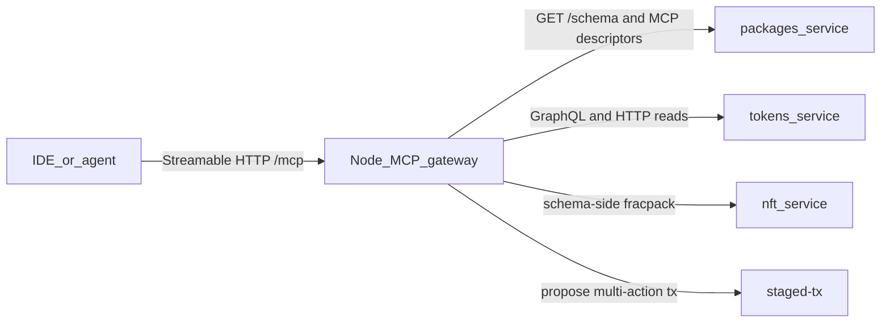
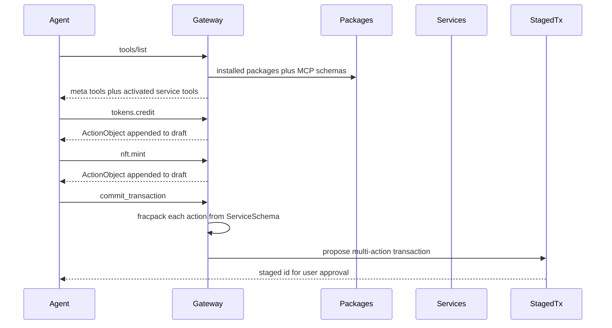

# On-chain service MCP schemas

A node-hosted Model Context Protocol (MCP) gateway that reads a per-service MCP schema from chain, exposes actions/queries/RPC/plugins as tools, and lets an agent compose one multi-service transaction.

Yes: an MCP server can run on a node and be reached remotely by an IDE. The MCP Streamable HTTP transport is a single HTTP endpoint (JSON-RPC POST, optional Server-Sent Events). Cursor, Claude, and similar clients can add that URL as a remote MCP server.

Do **not** give each service its own MCP server. An agent cannot usefully knit a multi-service transaction if it must open a new connection per account. Each service **publishes a schema**; the **node runs one gateway** that reads those schemas and exposes tools.

## What already exists

The write path an agent needs is already on chain. A transaction is just an ordered list of actions; each action names `sender`, `service`, `method`, and packed `rawData`. The JS client already packs many actions then pushes one transaction ([`rpc.ts`](packages/user/CommonApi/common/packages/common-lib/src/rpc.ts)).

Per-service **action** schemas are already stored and served:

- Install writes [`InstalledSchema`](packages/user/Packages/include/services/user/Packages.hpp) (`account` + [`ServiceSchema`](libraries/psibase/common/include/psibase/schema.hpp): types, actions, events, tables).
- [`GET /schema?service=tokens`](packages/user/Packages/src/RPackages.cpp) on the `packages` subdomain returns that JSON.
- `POST {service}/pack_action/{method}` packs one action **when the service wired** [`servePackAction`](libraries/psibase/common/include/psibase/servePackAction.hpp) — this is opt-in, not universal.
- The reliable pack path is **schema-side**: fetch `ServiceSchema`, pack JSON with fracpack (Rust `PrettyAction` and the Python test client already do this). The gateway should pack from schema and treat `/pack_action` as a convenience, not a dependency.
- `GET {service}/action_templates` returns placeholder JSON, not a real schema.

Reads are also already HTTP:

- `GET {service}/graphql` returns GraphQL SDL; `POST {service}/graphql` runs a query ([`serveGraphQL.hpp`](libraries/psibase/common/include/psibase/serveGraphQL.hpp)).
- GraphQL often lives on a **separate query-service account** (`profiles+1`, `registry+1`), not on the action service. Descriptors must link the pair.
- Other RPC lives in each service's `serveSys` (not catalogued today).
- Plugin WebAssembly Interface Type (WIT) worlds can be extracted by [`component-parser`](packages/user/CommonApi/common/packages/component-parser/src/lib.rs).

Discovery today is N+1: paginate `packages` GraphQL `installed { services }`, then `GET /schema?service=` per account. There is no bulk catalog. The gateway caches this; a later `GET /mcp-schema?all=1` (or include MCP descriptors in `installed()`) avoids repeating that from every client.

What is **missing** for an AI: human descriptions, a unified tool catalog, a composer session, a safe execute path, and a declared HTTP/plugin surface. `ServiceSchema` has types only — no prose, examples, or side-effect labels. It also lists `serveSys` as an action; generated tools must drop HTTP handlers and keep only transaction methods.

The existing Cursor MCP server lives in the sibling `psibase-dev-tools` repo (`psibase-mcp`, 19 static build/test/chain tools over stdio). It has no chain introspection, no signing, and no per-service tools. Keep it as the **dev-host** server; do not grow it into the on-chain gateway.

## Layer 1 — per-service MCP schema (the on-chain artifact)

Each service account gets an **MCP Service Descriptor** stored beside `InstalledSchema`. This is what “each service comes with its own MCP protocol schema” means.

**Hybrid authorship:**

1. **Generate** a baseline at package build/install from `ServiceSchema`, `GET /graphql` SDL, and plugin WIT.
2. **Override** with an optional authored file in the package (e.g. `mcp.json` / `mcp.yaml`) for descriptions, examples, hidden/dangerous tools, GraphQL operation templates, and HTTP routes that cannot be inferred.

Suggested shape (logical, not final JSON):

- `service`, `title`, `description`, `version`
- `queryService` — optional sibling account that hosts GraphQL (`tokens+1`)
- `exports` — package export names that resolve to this account (agents search by logical name, not only `AccountNumber`)
- `tools[]`, each with:
  - `name` — short, unique within the service (`credit`, not `tokens_credit`)
  - `kind` — `action` | `graphql` | `http` | `plugin`
  - `description` + `examples` (this is what makes tools usable by a model)
  - `inputSchema` — JSON Schema derived from fracpack / GraphQL / WIT types
  - `sideEffect` — `read` | `write` | `mixed`
  - `auth` — who must sign / which sender is implied
  - kind-specific payload: action method, GraphQL document, HTTP path+method, or WIT `interface.func`

Store it like schemas today: an `InstalledMcpSchema` row (or a well-known Sites file such as `/mcp/schema.json`) plus `GET /mcp-schema?service=…` on `packages` (or on the service itself).

Generation should be automatic for every installed service so first-party and third-party packages work without a hand-written file. Authored files are quality, not a gate.

## Layer 2 — one gateway on the node

Add a node-reachable MCP endpoint, e.g. `https://<host>/mcp` or the `mcp` subdomain.

**Prefer a native psinode (or thin sidecar) adapter** over a WASM `serveSys` for the transport: Streamable HTTP wants sessions and optional SSE. The adapter is a protocol translator; all truth still comes from chain HTTP/tables.

Remote access is just HTTPS to that endpoint. Bind/auth policy is separate from schema (see Security).

## Layer 3 — tools the agent actually sees

Dumping every action + GraphQL field + WIT func on a live chain will blow past client tool-list limits. Use **activation**, not a 500-tool dump.

**Always-on meta tools**

- `list_services` — installed packages/accounts, short blurb
- `use_services` — activate `["tokens","nft",…]`; those tools appear (MCP `tools/list_changed`)
- `describe_service` — full descriptor for one account
- `graphql` / `http_call` — escape hatches for reads not promoted to named tools
- `draft_status` / `clear_draft`
- `commit_transaction` — pack + TAPOS (transaction as proof of stake / last-irreversible ref) + execute path
- `simulate_transaction` — when a dry-run path exists

**Activated service tools** (the “simple tool calls”)

- `tokens.credit`, `tokens.uncredit`, …
- Named GraphQL ops from the descriptor (`tokens.getBalance`)
- Declared HTTP routes
- Plugin funcs **only on a host that can run plugins** (below)

**Write tools do not push.** They validate args against the descriptor, return a typed `ActionObject` `{sender, service, method, data}`, and append it to a **draft**. `commit_transaction` is the only tool that builds the wire transaction. That is how the agent knits Tokens + Nft + Invite into one atomic transaction.

Draft state: default **stateless** (client echoes the action list into `commit`) with an **optional session draft** keyed by `Mcp-Session-Id` for nicer multi-turn use.

Reads execute immediately (GraphQL/HTTP) and never enter the draft.

## Mapping the four surfaces

| Surface | Discover | Execute from node gateway |
|---|---|---|
| Actions | `ServiceSchema` minus `serveSys` / other HTTP handlers + MCP overrides. Skip hashed `#…` method names unless the descriptor gives a human alias. | Pack from schema (fracpack); `/pack_action` only if present |
| GraphQL | `GET {queryService}/graphql` SDL + named ops in MCP file | `POST {queryService}/graphql` now |
| HTTP/RPC | **Authored** in MCP file (`pack_action` / `graphql` / `action_templates` are known builtins) | Sibling-subdomain HTTP |
| Plugin WIT | WIT via component-parser + MCP overrides | **Not on the node** |

Plugins run in the browser Supervisor ([`plugin-host.ts`](packages/user/Supervisor/ui/src/plugin/plugin-host.ts)): prompts, keys, IndexedDB. A node MCP cannot honestly implement `kind: plugin`. Same descriptor, two hosts:

- **Node gateway** — actions, GraphQL, HTTP, transaction compose/commit
- **Browser / Supervisor MCP** (later) — WIT tools, using the same schema

Until the browser host exists, plugin tools are listed as `unsupported` on the node gateway (description only) so the agent knows they exist but does not fake a call.

## Execute and auth (recommended default)

A remotely reachable node must not hold user keys.

1. **Default:** `commit_transaction` packs the draft and **stages** it via [StagedTx](packages/system/StagedTx) (`propose`). The user accepts in the existing UI. This is already the “propose a bundle of actions” primitive.
2. **Dev / local node:** optional client-supplied key or unlocked local keyring, same idea as the `psibase` CLI. Never the public-node default.
3. **Later:** MCP elicitation / callback so the IDE wallet signs the digest and the gateway only pushes.

`sender` is an explicit argument on write tools (or a session default set once). The gateway does not invent the acting account.

## Security (non-optional if the endpoint is remote)

- Classify every tool `read` vs `write`. Writes only mutate the draft.
- Hide or extra-confirm system-dangerous actions (`setCode`, auth changes, package install) unless the session is privileged.
- Authenticate the `/mcp` HTTP endpoint (session token, mTLS, or local bind). Open CORS + no auth on a public producer is a write oracle.
- Rate-limit `commit` / GraphQL.
- Schema allowlists: authors can `exclude` tools; the gateway can have a node-level deny list.

## What we would build (when you want implementation)

This is design-only until you ask to implement.

1. **Descriptor spec** — JSON Schema for the MCP Service Descriptor; fracpack/`ServiceSchema` → JSON Schema mapping; GraphQL SDL / WIT import rules.
2. **Install path** — generate baseline at `setSchema` / postinstall; accept optional `mcp.json` from the package; serve `GET /mcp-schema?service=`.
3. **Gateway** — psinode (or sidecar) Streamable HTTP `/mcp`; meta tools + activation; draft compose; StagedTx commit; GraphQL/HTTP reads.
4. **Seed descriptors** — hand-enrich a few high-value services (Tokens, Accounts, Packages, StagedTx) so the first agent loop is actually good.
5. **Browser host (follow-up)** — Supervisor MCP implementing `kind: plugin` against the same descriptors.

## Open decisions (defaults above unless overridden)

- Execute path: StagedTx vs client-sign vs local-dev keys.
- Whether v1 HTTP MCP is native psinode or a WASM service with POST-only JSON-RPC.
- How aggressively to hide system actions on a public node.
